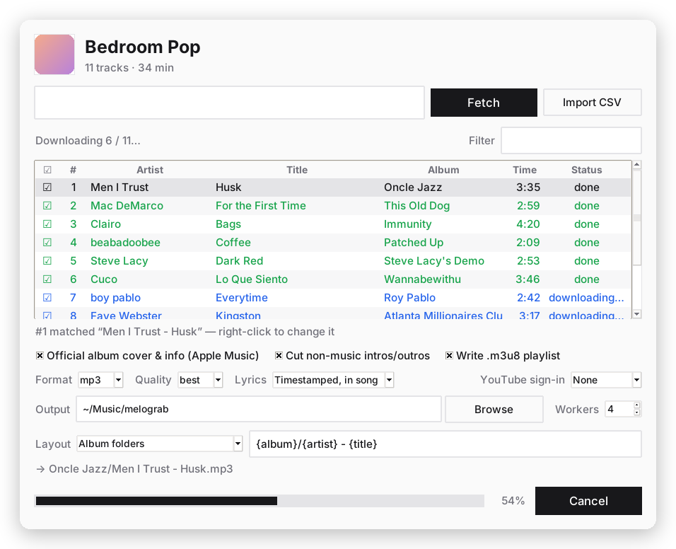
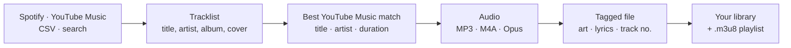

<p align="center">
  
</p>

<h1 align="center">melograb</h1>

<p align="center">
  Turn Spotify and YouTube Music playlists into a tidy, tagged music library — with cover art and synced lyrics.<br>
  No Spotify Premium, no API keys, no login.
</p>

<p align="center">
  <a href="https://github.com/Hamdan772/downloaded-music/releases/latest/download/melograb-macos-arm64.dmg"><b>Download for Apple Silicon</b></a>
  &nbsp;·&nbsp;
  <a href="https://github.com/Hamdan772/downloaded-music/releases/latest/download/melograb-macos-x86_64.dmg"><b>Download for Intel Mac</b></a>
  &nbsp;·&nbsp;
  <a href="https://github.com/Hamdan772/downloaded-music/releases">All releases</a>
</p>

<p align="center">
  <a href="https://github.com/Hamdan772/downloaded-music/releases/latest"></a>
  <a href="https://github.com/Hamdan772/downloaded-music/actions/workflows/tests.yml"></a>
  <a href="https://github.com/Hamdan772/downloaded-music/actions/workflows/macos-app.yml"></a>
  
</p>

<p align="center">
  <picture>
    <source media="(prefers-color-scheme: dark)" srcset="docs/screenshot-dark.png">
    
  </picture>
</p>

## How it works

1. **Paste a link** — a Spotify playlist, album, song or artist; a YouTube Music playlist or video; a CSV export; or just type `artist - song`. Several at once is fine.
2. **Review** — melograb shows the tracklist with each song's real album. Untick anything you don't want.
3. **Download** — every song is matched on YouTube Music, converted, tagged with album art and lyrics, and filed into your music folder.



melograb never touches Spotify's audio or DRM: Spotify (or your CSV) only tells it *which* songs you want, and the audio comes from YouTube — the same approach as spotDL.

## Features

**Sources**
- Public **Spotify** playlists, albums, songs and artists (top tracks), including `spotify.link` share links from the phone app
- **YouTube / YouTube Music** playlists, albums and single videos
- **CSV** exports from TuneMyMusic, Exportify and similar tools
- **Plain search** — `mac demarco - chamber of reflection`

**Matching you can trust**
- Ranks YouTube Music results by title, artist and duration, and avoids live versions, covers, sped-up edits and remixes you didn't ask for
- If the best match won't download, the runner-up is tried automatically
- Click a song to see what it matched; right-click to swap in a different YouTube link

**A library that looks right**
- Cover art, album, album artist, track *x of y*, year and an explicit flag on every file
- Synced lyrics from [lrclib.net](https://lrclib.net), embedded *and* saved as `.lrc` (plain lyrics when there's no synced version)
- Your choice of [file layout](#file-layout-templates), MP3 / M4A / Opus and quality, plus an `.m3u8` playlist in the original order
- Non-music intros and outros cut from music videos using [SponsorBlock](https://sponsor.ajay.app)

**Stays working**
- Bundles ffmpeg and deno, and updates **yt-dlp** from inside the app when YouTube changes something
- When YouTube asks to *confirm you're not a bot*, offers to use your browser's YouTube login and retry, in one click
- Re-running skips songs you already have, so you can retry or update a playlist at any time
- **Tools › Run Diagnostics** checks every component and tells you what's wrong

**Also**
- Add lyrics to music you already have (any source)
- Light and dark mode, Dock-icon CSV drops, notifications, keeps the Mac awake while downloading
- A full command-line version

## Install

### Mac app

Download the DMG for your Mac — **[Apple Silicon](https://github.com/Hamdan772/downloaded-music/releases/latest/download/melograb-macos-arm64.dmg)** (M1 and newer) or **[Intel](https://github.com/Hamdan772/downloaded-music/releases/latest/download/melograb-macos-x86_64.dmg)** — open it and drag **melograb** into **Applications**. Everything it needs is inside; there's nothing else to install.

> **First launch:** melograb isn't notarized by Apple yet, so macOS asks once. Right-click melograb in Applications and choose **Open**. On macOS 15 and newer, try to open it, then go to **System Settings › Privacy & Security** and click **Open Anyway**.

Not sure which Mac you have? **Apple menu › About This Mac** shows **Chip: Apple M…** (Apple Silicon) or **Processor: Intel**.

### From source (macOS and Linux; Windows untested)

Requires Python 3.11+, [ffmpeg](https://ffmpeg.org) and [deno](https://deno.com).

```bash
git clone https://github.com/Hamdan772/downloaded-music.git melograb && cd melograb
python3 -m venv .venv && source .venv/bin/activate
pip install -r requirements.txt
brew install ffmpeg deno python-tk     # macOS; use your package manager elsewhere
```

Then `python -m melograb.gui` for the app or `python -m melograb --help` for the CLI.

> On macOS, use a Python with Tk 8.6+ (e.g. Homebrew's `python@3.12` + `python-tk`). Apple's Command Line Tools Python ships Tk 8.5, which draws a blank window on Retina screens.

## Using the app

- **Paste and Fetch.** A link you've just copied is filled in automatically when you switch to melograb.
- **Pick songs.** Untick songs you don't want, click the ☑ header to toggle them all, or use **Filter**.
- **Check matches.** Click a row to see what it matched on YouTube, or why it failed.
- **Fix a wrong match.** Right-click → *Use a Different YouTube Link…*, paste the right one, and it's re-downloaded over the wrong file.
- **Retry Failed** re-runs only what didn't work; re-running a playlist later fetches only new songs.
- **YouTube sign-in** (top right of the options): which browser's YouTube login to use if YouTube asks for its bot check.
- **Tools ›** *Add Lyrics to Existing Folder…*, *Update yt-dlp*, *Run Diagnostics…*, *Show Log*. **Appearance ›** light, dark or match system.

Your folder, format, layout and options are remembered.

## Command line

```bash
# any mix of links, CSV files and searches
python -m melograb https://open.spotify.com/playlist/XXXXXXXX -o ~/Music/melograb
python -m melograb "https://music.youtube.com/playlist?list=PLxxxx" "dijon - coogie" my_export.csv

# see what everything matches before downloading
python -m melograb <url> --dry-run

# add lyrics to a library you already have
python -m melograb --add-lyrics ~/Music/Library
```

| Option | What it does |
| --- | --- |
| `-o DIR` | Output folder (default `./downloads`) |
| `-f mp3\|m4a\|opus` | Format (default `mp3`) |
| `-q best\|320\|256\|192\|128` | Quality when converting (default `best`) |
| `-t TEMPLATE` | [File layout](#file-layout-templates); `--no-album-folders` for a flat folder |
| `-w N` | Songs downloaded at once (default 4) |
| `--cookies-from-browser NAME` | Use this browser's YouTube login (`safari`, `chrome`, `firefox`, `brave`, `edge`, `arc`, …) |
| `--dry-run` | Show each song's match; download nothing |
| `--no-lyrics` · `--no-sponsorblock` · `--no-playlist-file` | Turn off lyrics, intro/outro cutting, or the `.m3u8` |
| `--add-lyrics DIR` | Add lyrics to every song in `DIR` (`--overwrite-lyrics` to replace) |
| `--self-test [--online]` | Check everything works (optionally with a real download) |

The CLI exits with status 2 if any song failed and prints the failures grouped by reason. Run it again to retry; finished songs are skipped.

## File layout templates

`/` separates folders. Fields: `{title}` `{artist}` `{album}` `{album_artist}` `{track}` `{total_tracks}` `{year}` `{date}` `{playlist}` `{position}`. Numbers take a width: `{track:02}` → `07`.

| Preset | Template | Result |
| --- | --- | --- |
| Album folders *(default)* | `{album}/{artist} - {title}` | `Oncle Jazz/Men I Trust - Husk.mp3` |
| Flat | `{artist} - {title}` | `Men I Trust - Husk.mp3` |
| Artist / Album / ## Title | `{album_artist}/{album}/{track:02} {title}` | `Men I Trust/Oncle Jazz/07 Husk.mp3` |
| Playlist folder, in order | `{playlist}/{position:03} {artist} - {title}` | `Chill/012 Men I Trust - Husk.mp3` |

## Troubleshooting

Start with **Tools › Run Diagnostics** (or `python -m melograb --self-test`). It checks every part of melograb, can test a real download, and **Copy Report** gives you something to paste into an issue.

<details>
<summary><b>YouTube says “confirm you're not a bot”</b></summary>

YouTube sometimes wants proof you're a person, especially after many downloads. melograb offers to use your default browser's YouTube login and retry, or you can set **YouTube sign-in** yourself (CLI: `--cookies-from-browser`). The login is read on your Mac and only ever sent to YouTube.

- **Safari** keeps its cookies private, so macOS needs you to give melograb **Full Disk Access** (System Settings › Privacy & Security › Full Disk Access).
- **Chrome, Brave, Edge, Arc…** show a one-time keychain prompt; click **Always Allow**.
- Without sign-in, waiting a while and clicking **Retry Failed** usually works too.
</details>

<details>
<summary><b>Every song fails</b></summary>

Almost always YouTube changed something and yt-dlp needs an update. The app checks on startup and shows an **Update now** banner (also under *Tools › Update yt-dlp*). From source: `pip install -U "yt-dlp[default]"`, and make sure ffmpeg and deno are installed.
</details>

<details>
<summary><b>A song matched the wrong version</b></summary>

Right-click it → *Use a Different YouTube Link…* and paste the right one. In the CLI, `--dry-run` shows every match up front.
</details>

<details>
<summary><b>The Album column is empty for some songs</b></summary>

Spotify rate-limits the per-song lookups on big playlists. Those songs fall back to the album name YouTube Music reports.
</details>

<details>
<summary><b>Where are the logs?</b></summary>

*Tools › Show Log*, or `~/Library/Logs/melograb/melograb.log` on macOS (`~/.cache/melograb/melograb.log` on Linux).
</details>

## Privacy

melograb has no accounts, analytics or servers of its own. It talks to:

| Service | Why |
| --- | --- |
| Spotify (public, logged-out pages) | Tracklists, albums, covers |
| YouTube / YouTube Music | Finding and downloading audio |
| [lrclib.net](https://lrclib.net) | Lyrics |
| [SponsorBlock](https://sponsor.ajay.app) | Where music videos' non-music parts are |
| PyPI and GitHub | Checking for yt-dlp and melograb updates |

If you turn on **YouTube sign-in**, your browser's YouTube cookies are read locally and sent only to YouTube.

## Building the Mac app

```bash
packaging/build_macos.sh        # → dist/melograb-<version>-macos-<arch>.dmg
```

This fetches static ffmpeg/ffprobe and deno for your CPU, builds `melograb.app` with PyInstaller, runs the app's own self-test, and wraps it in a drag-to-install DMG. GitHub Actions does the same for Apple Silicon and Intel on every relevant push (DMGs are under the run's **Artifacts**).

**Releasing:** bump `__version__` in `melograb/__init__.py` and add a section to [CHANGELOG.md](CHANGELOG.md). Then either run **Actions › macOS app › Run workflow** with *Publish a GitHub release* ticked (it creates the `v<version>` tag for you), or push the tag yourself:

```bash
git tag v0.5.0 && git push origin v0.5.0
```

Either way CI builds both DMGs, checks the version, and publishes the release with the changelog section as its notes.

**Signing and notarizing** (removes the first-launch warning) needs an Apple Developer account. Add these repository secrets and CI handles the rest: `MACOS_CERTIFICATE` (base64 of a *Developer ID Application* .p12), `MACOS_CERTIFICATE_PASSWORD`, `MACOS_SIGN_IDENTITY` (e.g. `Developer ID Application: Your Name (TEAMID)`), and `APPLE_ID`, `APPLE_TEAM_ID`, `APPLE_APP_PASSWORD` (an app-specific password).

## Development

```bash
pip install -e ".[dev]"
pytest
```

All network access is mocked. The tagging and end-to-end tests make real audio files with ffmpeg; the GUI tests need a display (CI uses `xvfb-run`). `python scripts/screenshots.py` regenerates the screenshots above.

## Credits

Built on [yt-dlp](https://github.com/yt-dlp/yt-dlp), [ytmusicapi](https://github.com/sigma67/ytmusicapi), [mutagen](https://github.com/quodlibet/mutagen), [RapidFuzz](https://github.com/rapidfuzz/RapidFuzz), [FFmpeg](https://ffmpeg.org), [Deno](https://deno.com), [lrclib.net](https://lrclib.net) and [SponsorBlock](https://sponsor.ajay.app); inspired by [spotDL](https://github.com/spotDL/spotify-downloader) and CSVmusic. Licenses of bundled components: [THIRD_PARTY_NOTICES.md](packaging/THIRD_PARTY_NOTICES.md).

## Legal note

Spotify's and YouTube's terms generally don't permit downloading content outside their own apps' offline features. Whether personal, non-redistributed use crosses into infringement is unsettled and depends on where you live. melograb only reads metadata Spotify already shows logged-out visitors and never bypasses a login, paywall or DRM. Use it only for music you have the right to access, and don't redistribute the files.
